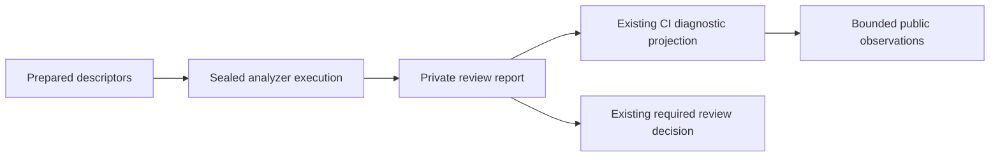

# Design: Preserve provenance at the existing CI output boundary

## Grounding and data flow

The controller prepares base/head project descriptors. Sealed analyzers execute with admitted roots and a cleared environment. Their private reports contain analyzer outcomes and findings. Existing inline Python snippets release bounded public diagnostics. That last projection loses analyzer side, exception class, and finding lifecycle information.

Public observations do not feed back into the required review decision. Candidate source and the independent signed reviewer retain separate identities and evidence.

## Alternatives and recommendation

| Approach | Benefit | Limitation and maintenance | Decision |
| --- | --- | --- | --- |
| Reuse existing logs/artifacts unchanged | No code change | Uploaded artifact paths exclude the private reports. Public structured-report output lacks the deciding fields. Repeating unchanged runs adds no evidence. | Insufficient for this failure. |
| Adapt existing inline projections | Reuse current private report access, bounds, allowlists, and trusted workflow ownership | Small duplicated projection sites need shared fixture expectations. | Recommended first unit. |
| Add a standalone diagnostic program | Could centralize projection | Adds a host executable and provenance/dispatch questions for the independent job. | Defer. |
| Provision native tools or replace analyzer execution | Might allow native acceptance execution | Changes signed closure, runtime resources, or acceptance ownership before the separate exceptions are known. | Excluded. |

## Proposed observations

Use only existing private report fields and pytest observation records. Validate them at the public-output boundary. Do not import subject Python, run subject helpers, inspect arbitrary host paths, or probe the capsule with extra commands.

- Analyzer identity comes from the existing finite allowlist. Side is `base`, `head`, or explicitly unavailable. Execution/evidence values come from the existing closed schema. Never infer that head failed from aggregate UNKNOWN.
- CrossHair classes reuse the existing fixed marker-to-enum mapping for timeout, process error, unrecognized output, execution error, and enumerated exception observations. Apply it consistently to readable structured and oversized reports. Never emit exception messages, import names, paths, or tracebacks.
- Pytest uses known fixed diagnostic codes and a small enumerated exception classification. An unrecognized failure emits an explicit unclassified value rather than guessing a cause from its anchor file.
- Pytest producer prefixes distinguish execution failure, evidence-reading failure, and the exact observer/JUnit/process reconciliation failure. Only the two known producer wrappers may be removed before interpreting an existing fixed diagnostic code or errno. Arbitrary wrappers remain unclassified.
- A known native skip detail may emit `native_prerequisites_not_supplied`. Absent or unexpected detail emits no claim about actual prerequisite presence. Do not echo environment values or skip text.
- Finding lifecycle permits only `introduced`, `fixed`, `unchanged`, or `unknown`. Status permits only `open`, `fixed`, or `waived-by-reference`. Emit `blocking` only when its type is exactly Boolean. Missing fields remain unavailable, never implicitly non-blocking. Preserve existing validated public locations.
- Bind observations to the already verified subject and reviewer identities. Do not accept new identity claims from arbitrary report strings or mix candidate and independent output. Public diagnostics remain observations rather than protected assurance.

Reuse current report-size, iteration, location, and output-count limits. Reject malformed/duplicate-key input where the current parser already does so. Do not loosen any parser to obtain additional data. Raw reports, receipts, logs, environment values, and free-form messages remain runner-private and outside uploaded artifact paths.

## Test placement and verification

Create `tests/unit/test_capsule_analyzer_diagnostics.py`. Extract and exercise the actual existing workflow snippets with bounded JSON fixtures using Python, without Bash or capsule launch. This avoids adding tests to the unrelated legacy shell-test file while retaining it in all applicable full verification.

The existing legacy exact-output expectation requires a narrow update for newly visible structured-report fields. Keep all its scenarios and exact assertions. Do not add cases to that file, suppress its shell tests, or change its runtime dependencies to satisfy sealed analysis.

Use observable assertions: exact allowed public fields, ordinary/oversized parity, correct side, fixed non-blocking versus active blocking status, unknown handling, and absence of seeded private strings. Include malformed input, duplicate keys, invalid Booleans, bounds, and invalid locations. Verify that diagnostic success or failure cannot replace the captured review exit or its required failing outcome.

Follow spec, tests, RED evidence, implementation, GREEN evidence. Run strict OpenSpec validation, format, types, lint, YAML, imports, signatures, contracts, SMART/full tests, SpecFact review, and the prescribed independent review. Preserve all pre-existing tests. The Darwin exception may defer only its documented capsule component to blocking exact-head Linux review and must remain DEFERRED.

## Stop conditions and risks

The existing Linux exceptions may reveal an actual import, compatibility, collection, or runtime resource defect. Those alternatives are hypotheses, not approved repairs. Stop after the diagnostic unit and present the observed class and side with the smallest supported next action. No timeout, dependency, closure, test selection, or enforcement change is authorized here.

The main failure modes are leaking private data, presenting base history as active head failure, and promoting diagnostics to authority. Fixed allowlists/bounds, explicit lifecycle/side, and unchanged review exit handling address them. Revert the projection/test unit to roll back.
